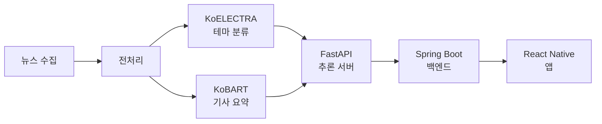

# DeepLearning

# Newgnal — Deep Learning

금융 뉴스 서비스 'Newgnal'의 AI 모델 저장소입니다.

## 프로젝트 개요

| | |
|---|---|
| 기간 | 2025.03 ~ 2025.08 (6개월) |
| 소속 | TAVE 15기 (IT 연합동아리), 10인 팀 |
| 저장소 범위 | AI 모델 학습 및 추론 (프론트엔드·백엔드는 별도 저장소) |

## 문제 정의

금융 뉴스는 하루에도 수백 건씩 쏟아지지만, 관심 있는 테마의 기사를 골라 읽기는 어렵습니다.
기사를 테마별로 자동 분류하고 본문을 짧게 요약해 제공하면 탐색 비용을 줄일 수 있다고 보았습니다.

## 시스템 아키텍처

FastAPI 추론 서버는 Docker 이미지로 패키징하여 AWS EC2에 배포했습니다.

## 모델

### 1. 테마 분류 — KoELECTRA (`theme/`)

금융 뉴스를 13개 테마로 분류합니다.

| 항목 | 내용 |
|---|---|
| 사전학습 모델 | KoELECTRA |
| 클래스 수 | 13개 테마 |
| Accuracy | 94.6% |
| Macro F1 | 0.946 |

클래스별 기사 수가 고르지 않아, 정확도만으로는 성능을 판단하기 어렵다고 보고 Macro F1을 함께 확인했습니다.

### 2. 기사 요약 — KoBART (`summary/`)

기사 본문을 짧게 요약합니다.

| 항목 | 내용 |
|---|---|
| 사전학습 모델 | KoBART |
| 학습 전략 | Encoder freezing |
| 학습 데이터 | 직접 구축한 기사-요약 쌍 |

공개된 한국어 금융 뉴스 요약 데이터셋이 없어 학습 데이터를 직접 구축했습니다.
데이터 규모가 크지 않아 인코더를 동결하고 디코더만 학습해 과적합을 줄였습니다.

## 기술 스택

`Python` `PyTorch` `Transformers` `KoELECTRA` `KoBART` `FastAPI` `Docker` `AWS EC2`

## 전체 서비스 구조

- Frontend: React Native + Expo
- Backend: Spring Boot
- AI Serving: FastAPI (본 저장소)
